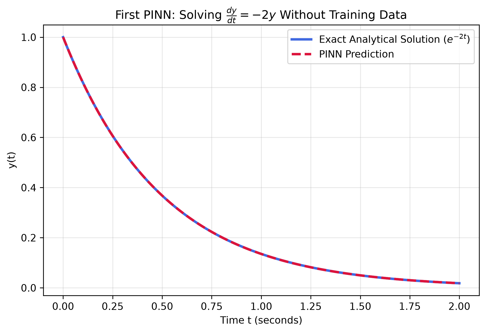
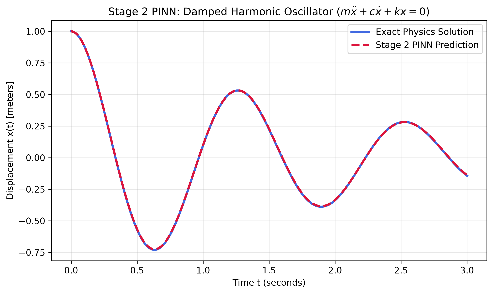
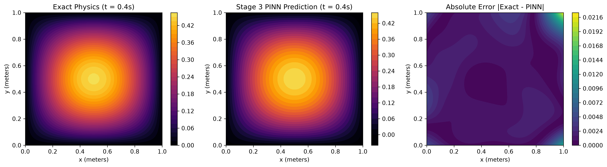
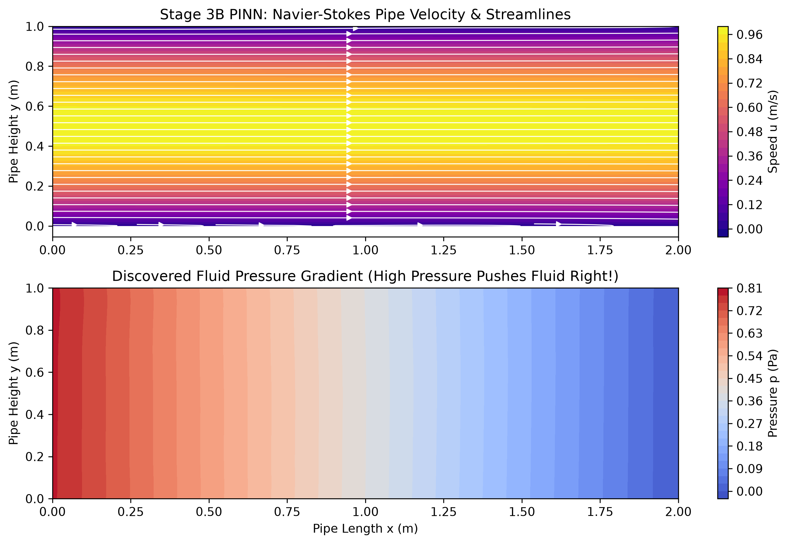

# Physics-Informed Neural Networks (PINNs) for ODEs & PDEs

A mesh-free scientific machine learning framework built from scratch in **PyTorch** to solve Ordinary and Partial Differential Equations using automatic differentiation (`torch.autograd`)—with **zero labeled training data**.

## Overview & Methodology
Instead of training on large datasets, each neural network uses smooth `Tanh` activations and embeds physical governing laws, initial conditions, and boundary conditions directly into its loss function.

## Implemented Physics Systems

### 1. 1st-Order Exponential Decay (`first_pinn.py`)
* **Governing Equation:** $\frac{dy}{dt} = -ky, \quad y(0) = 1$
* **Result:** Converged to the exact analytical curve with MSE $\approx 2 \times 10^{-8}$.

### 2. 2nd-Order Damped Harmonic Oscillator (`second_pinn.py`)
* **Governing Equation:** $m\frac{d^2x}{dt^2} + c\frac{dx}{dt} + kx = 0$
* **Result:** Generalized across underdamped, critically damped ($\gamma = \omega_0$), and overdamped regimes using double automatic differentiation.

### 3. 2D Transient Heat Diffusion PDE (`third_pinn.py`)
* **Governing Equation:** $\frac{\partial T}{\partial t} = \alpha\left(\frac{\partial^2 T}{\partial x^2} + \frac{\partial^2 T}{\partial y^2}\right)$
* **Result:** Solved 3D space-time $(x, y, t)$ temperature evolution on a Dirichlet-bounded metal plate without spatial meshing.

### 4. 2D Steady-State Navier-Stokes Fluid Flow (`fourth_pinn.py`)
* **Governing Equations:** Coupled conservation of mass and $x, y$ momentum equations for incompressible Poiseuille channel flow.
* **Result:** Reconstructed parabolic velocity streamlines and inferred the hidden internal pressure gradient purely from boundary conditions.

## Tech Stack
* **Python 3.12**, **PyTorch** (`autograd`), **NumPy**, **Matplotlib**
